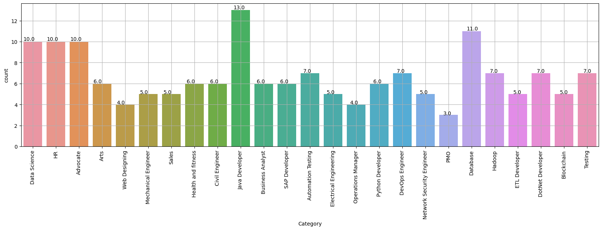

# Automated Resume Screening

A machine learning pipeline that reads a resume's raw text and predicts which job category it belongs to (Data Science, HR, Java Developer, and so on). It cleans the text, turns it into TF-IDF features, and trains a K-Nearest Neighbors classifier. The goal is to sort incoming resumes into the right role automatically, so recruiters don't have to triage them by hand.

**Highlights**
- Classifies resumes into **25 job categories** with **0.82 test accuracy** (stratified hold-out set)
- End-to-end NLP pipeline: regex text cleaning → TF-IDF → One-vs-Rest KNN
- Exploratory analysis of the category balance and vocabulary, with charts
- Ready-to-use inference on any new resume text

[**View the notebook →**](Automated%20Resume%20Screener.ipynb)

## Table of Contents

- [Overview](#overview)
- [Dataset](#dataset)
- [Project Workflow](#project-workflow)
- [Results](#results)
- [Getting Started](#getting-started)
- [Usage: Classify a New Resume](#usage-classify-a-new-resume)
- [Tech Stack](#tech-stack)
- [Limitations and Future Work](#limitations-and-future-work)
- [Repository Structure](#repository-structure)

## Overview

Recruiters often get hundreds of resumes for every opening. This project treats screening as a **multi-class text classification** problem:

1. **Input:** the unstructured text of a resume
2. **Output:** one of 25 job categories

All of the work is in a single Jupyter notebook, `Automated Resume Screener.ipynb`. It covers exploratory data analysis, text preprocessing, feature engineering, model training, evaluation, and predictions on new resumes.

## Dataset

- **Source:** [Kaggle: aniketnandi/resume-dataset](https://www.kaggle.com/datasets/aniketnandi/resume-dataset) (also on [Google Drive](https://drive.google.com/file/d/1L5HyJRtNgTascKlQ9UpFSzCu4-h27wWI/view?usp=drive_link))
- **File:** `UpdatedResumeDataSet.csv`
- **Columns:**
  - `Category`: the job category label
  - `Resume`: the raw resume text
- **Size:** 166 unique resumes after duplicates are removed

The data covers **25 categories**:

| | | | | |
|---|---|---|---|---|
| Data Science | HR | Advocate | Arts | Web Designing |
| Mechanical Engineer | Sales | Health and Fitness | Civil Engineer | Java Developer |
| Business Analyst | SAP Developer | Automation Testing | Electrical Engineering | Operations Manager |
| Python Developer | DevOps Engineer | Network Security Engineer | PMO | Database |
| Hadoop | ETL Developer | DotNet Developer | Blockchain | Testing |

The classes are fairly imbalanced. Java Developer has the most samples (13) and PMO has the fewest (3).



## Project Workflow

```
Raw resume text
      │
      ▼
Exploratory data analysis   →  category counts, pie chart, word frequencies, word cloud
      │
      ▼
Text cleaning (regex)       →  remove URLs, hashtags, mentions, punctuation, non-ASCII, extra whitespace
      │
      ▼
Label encoding              →  Category → integer labels (LabelEncoder)
      │
      ▼
TF-IDF vectorization        →  sublinear TF, English stop words removed (~7,350 features)
      │
      ▼
Stratified 80/20 split      →  132 training / 34 test resumes
      │
      ▼
Classifier                  →  One-vs-Rest K-Nearest Neighbors
      │
      ▼
Evaluation and prediction   →  accuracy, classification report, inference on new resumes
```

### 1. Exploratory Data Analysis
- Category distribution shown as a count plot and a pie chart
- Duplicate detection and removal
- The 50 most frequent words (via NLTK, with stop words removed)
- A word cloud of the whole corpus

### 2. Text Preprocessing
The `cleanResume()` function normalizes each resume:
- Removes URLs, `RT`/`cc` tokens, hashtags, and @mentions
- Removes punctuation and non-ASCII characters (resumes scraped from the web often contain mis-encoded bullet points)
- Collapses repeated whitespace

### 3. Feature Engineering
`TfidfVectorizer(sublinear_tf=True, stop_words='english')` turns each cleaned resume into a sparse TF-IDF vector.

### 4. Modeling
A `OneVsRestClassifier(KNeighborsClassifier())` is trained on a stratified 80/20 train/test split (`random_state=42`). The notebook also has a cell with experiments using Logistic Regression, Random Forest, and a linear SVM.

## Results

| Model | Train Accuracy | Test Accuracy |
|---|---|---|
| One-vs-Rest KNN | **0.89** | **0.82** |

The notebook includes a full per-class precision, recall, and F1 report for both the training and test sets.

## Getting Started

### Prerequisites
- Python 3.10+
- Jupyter Notebook or JupyterLab (or run it on [Kaggle](https://www.kaggle.com/) or Google Colab)

### Installation

```bash
git clone https://github.com/aniketnandi/automated-resume-screening.git
cd automated-resume-screening

pip install -r requirements.txt
python -m nltk.downloader stopwords punkt punkt_tab
```

### Getting the Data

**Option A: Kaggle (used by the notebook)**

The notebook downloads the dataset automatically with `kagglehub`:

```python
import kagglehub
dataset_path = kagglehub.dataset_download('aniketnandi/resume-dataset')
```

If the download asks for credentials, run `kagglehub.login()` first.

**Option B: Manual download**

Download `UpdatedResumeDataSet.csv` from the [Google Drive link](https://drive.google.com/file/d/1L5HyJRtNgTascKlQ9UpFSzCu4-h27wWI/view?usp=drive_link). Skip the download cell and set `dataset_path` to the folder that contains the file:

```python
dataset_path = 'path/to/folder'
```

### Run

```bash
jupyter notebook "Automated Resume Screener.ipynb"
```

Run the cells from top to bottom.

## Usage: Classify a New Resume

After you train the model, you can classify any resume text. Clean it and vectorize it with the **same** fitted vectorizer you used for training:

```python
sample_resume = """
Experienced software engineer with 3 years in Python development, machine learning,
and cloud deployments using AWS. Strong foundation in data structures and REST API design.
"""

sample_cleaned = cleanResume(sample_resume)
sample_vectorized = word_vectorizer.transform([sample_cleaned])

predicted_label = clf.predict(sample_vectorized)
print("Predicted Category:", le.inverse_transform(predicted_label)[0])
# Predicted Category: Data Science
```

## Tech Stack

- **Language:** Python
- **Data handling:** pandas, NumPy
- **NLP:** NLTK, regular expressions, scikit-learn `TfidfVectorizer`
- **Machine learning:** scikit-learn (KNN, One-vs-Rest, LabelEncoder, train/test split, metrics)
- **Visualization:** Matplotlib, Seaborn, WordCloud
- **Data access:** kagglehub

## Limitations and Future Work

- **Small dataset:** with only 166 unique resumes and 3 to 13 per class, some categories have just one test sample. That makes per-class scores noisy.
- **Possible improvements:**
  - Use cross-validation and hyperparameter tuning (for example, `k` for KNN)
  - Try transformer embeddings such as BERT or Sentence-Transformers
  - Rank resumes against a job description (similarity scoring), not just classify them
  - Parse PDF and DOCX resumes directly
  - Deploy as a web app with Streamlit, Flask, or FastAPI

## Repository Structure

```
automated-resume-screening/
├── Automated Resume Screener.ipynb   # Full pipeline: EDA → preprocessing → modeling → inference
├── images/
│   └── category_distribution.png     # Chart used in this README
├── requirements.txt                  # Python dependencies
└── README.md
```

## Author

**Aniket Nandi** · [GitHub](https://github.com/aniketnandi)
